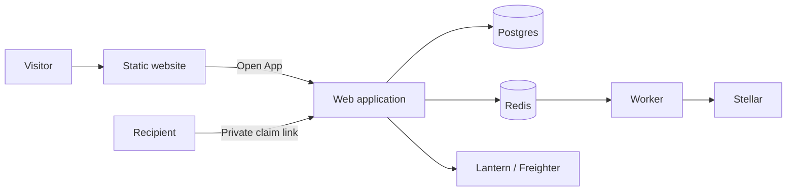

# Kleym website and app

Kleym follows the two-service structure demonstrated by HeyPay: a static public website with **Open App**, and a separate authenticated application. Both services use `webnxt-2030/kleym`, branch `develop-ade`. Domain attachment belongs to Artisam Labs' senior developer.

## Destinations

| Service | Intended domain | Responsibility |
| --- | --- | --- |
| `kleym-landing` | `https://kleym.xyz` | Static marketing homepage, illustrations, animation and Open App links |
| Existing web app | `https://app.kleym.xyz` | Login, dashboard, campaign creation and management, public recipient claims, APIs |
| Existing worker | No public domain | Confirmation, expiry/reconciliation and background work |
| Existing Postgres and Redis | Private networking | Application persistence and queues |



The landing service has no database, Redis, session, sponsor, recovery-phrase or WalletConnect configuration. Its final image contains eight public files and a dependency-free HTTP server. It serves only GET/HEAD, with no cookies, API, claim or login endpoints. Its external animation module shares the app homepage's controller; no React hydration or Next runtime is sent. Both homepages share `MarketingHome`, the illustration and CSS to avoid design drift.

## Public landing configuration

| Variable | Meaning |
| --- | --- |
| `LANDING_APP_URL` | Public HTTPS app origin; Open App targets its root |
| `LANDING_SITE_URL` | Public HTTPS website origin; canonical metadata |
| `LANDING_NETWORK` | `testnet` by default; `public` changes explanatory copy only |

These values are build arguments and require rebuilding the landing service. Origins reject credentials, paths, queries, fragments, private hosts and secret-shaped values. Local HTTP origins require `build:landing --allow-local` explicitly. Changing the landing label cannot enable Mainnet in the app.

## Application entry and compatibility

Set the server-only `MARKETING_SITE_URL` on the web app after the standalone website is healthy. The app root then redirects according to its resolved session:

| Session | App root destination |
| --- | --- |
| Anonymous or invalid | `/login` |
| Authenticated | `/dashboard` |
| Pending second factor | `/login/mfa` |
| Required second-factor enrolment | `/settings/security?required=1` |

Login, security enrolment and not-found home links target the separate website. Explicit logout remains in the authenticated navigation. When `MARKETING_SITE_URL` is empty, the app root retains the previous homepage: this is the compatibility and rollback path. Campaign, API and recipient routes retain their current paths. No campaign data migration is involved.

## Railway rollout

1. Merge the qualified source into `develop-ade`. Existing app and worker builds initially retain the compatibility homepage.
2. Create `kleym-landing` in the **senior developer's shared project** `57849f8f-8c9f-4565-8b88-6faf9ce085dd`, Testnet environment `72ccf46d-3e64-4bcb-bde8-9d4af62157ff`.
3. Select Dockerfile `landing/Dockerfile`, explicit config path `/railway.landing.json`, port 8080 and `/health`. Add only the three public landing settings. Connect the same repository and `develop-ade` branch.
4. Qualify the generated Railway website, its assets, headers and Open App destination before setting `MARKETING_SITE_URL` on the app.
5. Verify signed-out root → login, signed-in root → dashboard, home backlinks, mobile layout, existing campaign and claim routes, and logout.

The explicit landing config prevents the repository's app startup/health settings from being applied to the static service. Railway currently deprecates JSON/TOML configuration and documents a December 1, 2026 cutoff. Migrate **all existing project services together** to its supported configuration before that deadline; do not apply a partial infrastructure plan that omits the database or other services. See [Railway infrastructure configuration](https://docs.railway.com/infrastructure-as-code) and [Docker builds](https://docs.railway.com/builds/dockerfiles).

Rollback: clear `MARKETING_SITE_URL` and redeploy the web app, restoring its previous homepage. Keep the old application address available. The landing service can be redeployed to its previous image or stopped independently; it stores no user data. Do not delete the database, Redis or campaign records.

## Senior developer's domain handoff

1. Attach `kleym.xyz` to `kleym-landing` and `app.kleym.xyz` to the existing web service. Configure the DNS records Railway supplies and verify TLS.
2. Rebuild the landing service with `LANDING_SITE_URL=https://kleym.xyz` and `LANDING_APP_URL=https://app.kleym.xyz`.
3. Change the application's `MARKETING_SITE_URL` to `https://kleym.xyz`; coordinate `APP_URL=https://app.kleym.xyz` on web and worker. Review SSO callbacks and passkey RP/origin migration before changing the app hostname. Existing passkeys may need recovery/re-enrolment because their RP ID is hostname-bound.
4. Add the **application origin** to Reown's allowed origins. The marketing website does not connect wallets.
5. Keep the previous app hostname serving old exported claim URLs throughout their lifetime. Do not redirect private fragment-bearing claims without separately qualifying that flow.
6. Lantern's curated app entry should target the **application** origin, not the marketing site. Lantern embedding origins, frame policy and wallet bridge still require their own integration qualification.

This work does not enable Mainnet, change sponsor keys, move funds, attach domains, or qualify actual Android/native-wallet approvals. These remain separate release gates.

## Local verification

```text
pnpm exec vitest run tests/lib/config/landing.test.ts
pnpm build:landing
pnpm verify:landing
pnpm start:landing
```

Responsive and motion checks reuse `scripts/verify-homepage.mjs` and `scripts/verify-homepage-motion.mjs` in `static` mode with the separate app base. `compatibility` is an explicit local-only harness option when the app marker is not active. CI's browser job activates `MARKETING_SITE_URL` and tests anonymous/authenticated app entry. Local compatibility results must not be described as active-root proof.
